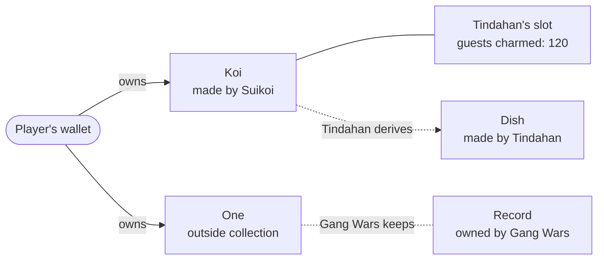
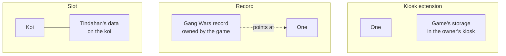

# Start here

Continuum lets games build on each other's objects on Sui without asking permission. This page explains the idea with one running example, then the few Sui basics you need, then exactly what Continuum adds on top of Sui.

## The running example

Four pieces, used on every page of these docs:

- **Koi**: an object made by the game **Suikoi**. Suikoi follows the whole standard.
- **Tindahan**: a second game, a restaurant sim. A player displays their koi at the restaurant, and Tindahan keeps a "guests charmed" count on the koi. The chef also cooks a signature **Dish** in the koi's pattern.
- **A One**: an NFT from **The Ones**, an outside collection that has never heard of Continuum.
- **Gang Wars**: a game that keeps each One's wins in a **record** it owns.

Solid arrows are ownership; the plain line is a slot on the koi. Dotted lines are verified provenance links: the Dish was made from the koi, and the record is about the One.

## Sui in five minutes

Only what you need for Continuum.

| Term | In plain words |
| --- | --- |
| **Object** | Everything on Sui is an object with its own ID. A koi is an object. Usually a wallet owns it, and the owner must sign to change it. |
| **Type and module** | Each object has a type (`Koi`) defined in a module (`suikoi::koi`). **Only that module** can create the type or touch its fields. Other code can't, by language rule. |
| **UID** | The object's identity field. Whoever can get `&mut UID` can attach extra data to that object. By default only the type's own module can. |
| **Dynamic field** | Extra named data attached to an object after it was created, like a labeled shelf. Its name is a **key**. Built into Sui. |
| **Key** | A small struct used as a dynamic field's name. Only the module that defines the key struct can create it, so only that module can write or remove fields under it. |
| **Kiosk** | A personal display case for NFTs. The creator sets sale rules (royalties); nothing leaves a locked kiosk except through a sale. Apps take an item out and put it back within one transaction. |
| **Transaction** | One signed bundle of calls that succeeds or fails as a whole. A game can take a koi out of a kiosk, use it, and put it back in one transaction. |

## Three places a game can keep data about an object

| | Slot | Record | Kiosk extension |
| --- | --- | --- | --- |
| Where the data lives | On the object itself | In a separate object the game owns, pointing at the object | In the owner's kiosk, next to the object |
| Needs the object's author to opt in | **Yes** (expose `uid_mut`) | No | No |
| Who signs each write | The object's owner | The game | The game, after a one-time install |
| Follows the object when it's sold | Yes | Yes (it points at the object's ID) | No, stays in the seller's kiosk |
| Example | Tindahan's "guests charmed: 120" on a koi | Gang Wars' wins for One #123 | A game's per-kiosk settings |

## What Sui already gives, and what Continuum adds

| A game wants to | Sui already gives | Continuum adds |
| --- | --- | --- |
| Attach its data to another game's object | Dynamic fields; keys only their module can create | **Rule 1:** a convention that types expose `uid_mut` (with an owner lock), so every game knows where to attach |
| Prove "this was made from that" | Nothing | **Rule 2:** `provenance::derive(&source)`, valid only with the source in the same transaction |
| Know what another game's fields mean and how its art may be used | Type names and structure; package names in the Move Registry | **Rule 3:** a manifest describing fields, types made and read, and license |
| Use an outside collection | Reading any object | **Records**: game-owned objects that point at the item through `derive` |
| Use up another game's object (cook, craft, ascend) | Freezing or deleting, only by the type's own module | **Rule 4 (draft):** retire by freezing, the output derives from the input, one shared event |

Continuum is deliberately thin: one small Move package plus conventions. Like ERC-721 on Ethereum, the value is everyone doing the same thing the same way.

## Who has to opt in to what

| Piece | Who opts in | What the source collection must do |
| --- | --- | --- |
| Slots (Rule 1) | The **object's author** writes `uid_mut` | This is the one thing it must do |
| Provenance (Rule 2) | The **game making the new thing** calls `derive` | Nothing |
| Records | The **game** creates and owns them | Nothing |
| Manifest (Rule 3) | Each **game** that wants to be found | Nothing |
| Retire (Rule 4, draft) | The **object's author** offers `retire` and sets its rules | It must offer `retire`; otherwise nothing can be used up |

That's why a collection like The Ones works with zero changes on its side. Gang Wars' record stores a provenance link to the One; `derive` only reads the One, so The Ones' code never runs, and the only consent needed is the holder's signature. Only slots need the author's cooperation.

## Next

- [standard.md](standard.md): each rule, why it exists, exactly what to write.
- [integrating.md](integrating.md): how a new or existing game joins.
- [faq.md](faq.md) and [glossary.md](glossary.md).
