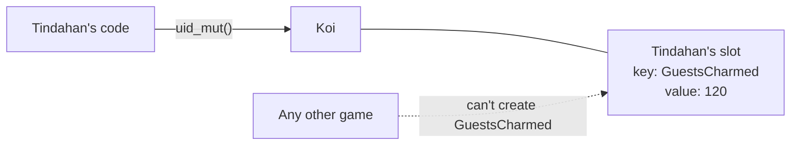
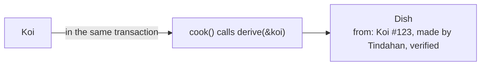
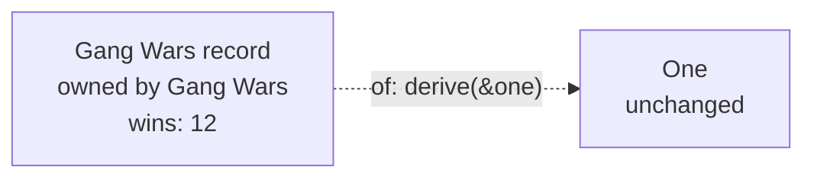

# The standard (draft v0)

Three rules. A game follows the ones that apply to it. Everything else (field names, stat scales, trust, economy) stays up to each game, so common conventions can come from use. This draft becomes a one-page spec after two games have shared an object for real.

New to the terms? Read [concepts.md](concepts.md) first. The examples below use its running example: Suikoi's **Koi**, Tindahan's **Dish**, The Ones' **One** and Gang Wars' **record**.

---

## Rule 1: Open slots

**Why.** Sui lets any object carry extra data (dynamic fields), but only code that can reach the object's `UID` can attach it, and by default that's only the type's own module. If Tindahan wants to keep a "guests charmed" count on a koi displayed at a player's restaurant, Suikoi has to let it.

**What the object's author does.** Expose the `UID` through a function named `uid_mut`, with an owner lock:

```move
public struct Koi has key, store {
    id: UID,
    // ...Suikoi's own fields...
    locked: bool,
}

/// Rule 1: other games may attach their own data. Aborts if the owner locked the koi.
public fun uid_mut(koi: &mut Koi): &mut UID {
    assert!(!koi.locked, ELocked);
    &mut koi.id
}
```

**What another game does.** Attach data under a key struct only it can create:

```move
module tindahan::display;
use sui::dynamic_field as df;

public struct GuestsCharmed has copy, drop, store {}   // slot key, no public constructor

/// The koi charmed another guest at the player's restaurant.
public fun charm_guest(koi: &mut Koi) {
    let uid = koi.uid_mut();
    if (df::exists_(uid, GuestsCharmed {})) {
        let n: &mut u64 = df::borrow_mut(uid, GuestsCharmed {});
        *n = *n + 1;
    } else {
        df::add(uid, GuestsCharmed {}, 1u64);   // add aborts if the field already exists
    };
}
```



**What it guarantees.**
- The koi's owner signs every change (it's their object).
- Each game can only write slots under its own key types.
- Nobody but Suikoi can change the koi's own fields (genes, grade, parents), and nobody can delete the koi through `uid_mut`.
- The owner can lock the koi to stop new slots.

**What's Sui and what's Continuum.** Dynamic fields and key privacy are built into Sui. Continuum adds only the convention: expose it, under this name, with a lock. Sui's own Kiosk does the same for kiosks (`kiosk::uid_mut_as_owner`).

**If a type doesn't do this** (most existing collections): games use a **record** instead. See below.

---

## Rule 2: Verified provenance

**Why.** When Tindahan's chef cooks a signature Dish in a koi's pattern, anyone should be able to tell, without trusting Tindahan, that the Dish really came from that koi, so a rare koi's dish can't be faked. A plain stored ID proves nothing; anyone can type an ID.

**What the making game does.** Call `derive` with the source in the same transaction and store the result:

```move
use continuum::provenance::{Self, Provenance};

public struct Tindahan has drop {}   // the game's witness, no public constructor

public struct Dish has key, store { id: UID, from: Provenance }

/// A signature dish in the koi's pattern. The koi isn't used up.
public fun cook(koi: &Koi, ctx: &mut TxContext): Dish {
    Dish { id: object::new(ctx), from: provenance::derive(Tindahan {}, koi, ctx) }
}
```



**What it guarantees.**
- The record stores the source's ID and full type, plus which game made it (from the witness type).
- It can only be made by `derive`, which needs the real source object present. It can't be copied onto another object.
- Sources the chain can't check (other chains, typed-in IDs) use `provenance::claim(witness, caip19, ctx)` and are marked **unverified**.

**Who opts in.** Only the game making the new thing. The source needs nothing, so this works on any Sui object, including The Ones.

---

## Rule 3: Manifest

**Why.** Types show structure (`grade: u8`), not meaning ("0 to 4, S is 4") or reuse rights. Builders need both before they use your objects.

**What a game does.** Publish a manifest (JSON, on Walrus or GitHub) and link it with its hash. Format: [`manifest/schema.json`](../manifest/schema.json). It covers:
- the types you make, and their fields' meaning;
- slots you attach to others' objects, and the outside types you read;
- your provenance witness;
- the license for your art and your on-chain data;
- optional `custody`: whether your objects sit in Kiosks, are locked, and your transfer policy.

**Where the link lives.** In your package's metadata in Sui's Move Registry (MVR): set `continuum.manifest` (the URI) and `continuum.manifest_hash` (32-byte hash, hex) with `@mvr/metadata::package_info::set_metadata`. Creating that record needs your package's UpgradeCap. Indexers find Continuum games by these keys. (The repo still contains an older `continuum::registry` module; it will be removed before testnet.)

**Trust.** No names on chain; trust follows the package ID. Which games you trust is your call.

---

## Records: using objects that don't follow Rule 1

A **record** is an object your game owns that points at someone else's object and holds your data about it.

```move
public struct GangWarsRecord has key {
    id: UID,
    of: Provenance,   // derive(&one): verified link to the One
    wins: u64,
}
```



- Created once with the holder's signature (the One must be in the transaction for `derive`). If it's in a Kiosk: `kiosk::borrow_val`, then `derive`, then `kiosk::return_val`, in one transaction.
- After that, the game updates it without asking the player.
- It keeps pointing at the One if the One is sold; the game checks the current owner before acting.
- For items on other chains, use `claim` with the item's CAIP-19 ID (unverified).

---

## Left out on purpose

- Trust and anti-cheat: each game decides which packages and origins it trusts.
- Balance, stat scales, shared field names.
- Economy of any kind: tokens, fees, royalties. Kiosk sale rules are each collection's choice.
